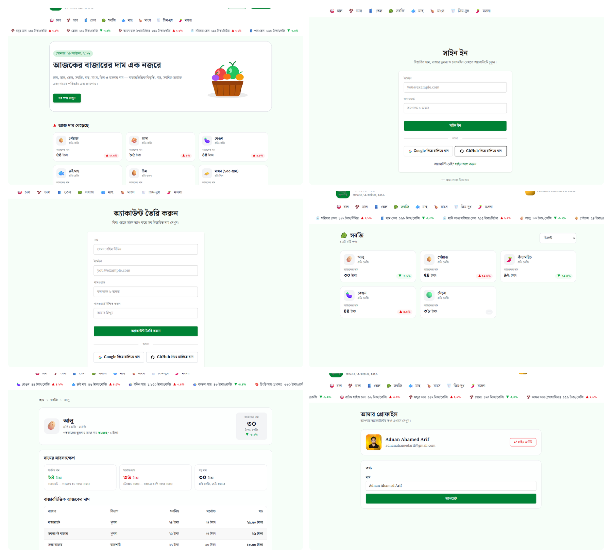

# বাজার দর (Bazar Dor)

## A Bangla web app for tracking the daily prices of everyday essentials across Bangladesh's markets. Browse products by category, see which prices went up or down today, compare prices market by market, and sign in to view full details.

  

Live site: https://adnan-bazar-dor.vercel.app/

## ✨ Features

- **Daily price ticker** — quickly spot products whose prices increased or decreased.
- **Price trends** — separate sections for products with rising and falling prices.
- **Browse by category** — explore products and sort prices from low to high or high to low.
- **Product price details** — view minimum, maximum, and average prices.
- **Market-wise comparison** — compare prices across markets and divisions.
- **Historical comparison** — compare today’s prices with yesterday, last week, and last month.
- **Secure sign in** — create an account or sign in to access protected product details.
- **Profile management** — view account information and update your name.
- **Responsive Bangla interface** — Bangla labels, digits, and units for a familiar local experience.
- **Helpful loading and error states** — loading skeletons and a custom 404 page.

## 🧰 Tech Stack

| Technology | Purpose |
|---|---|
| Next.js 16 (App Router)| Web application |
| TypeScript | Type-safe code |
| Tailwind CSS + DaisyUI | Styling and UI |
| Better Auth | Authentication |
| MongoDB Atlas | Database |
| React Marquee Text | Scrolling price ticker |
| React Hot Toast | Notifications |
| Vercel | Deployment |

---

